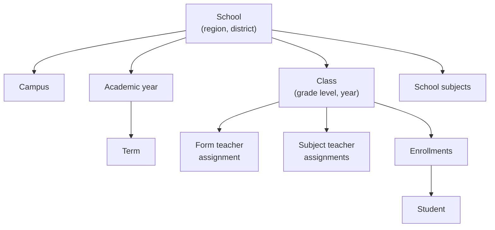

# Academic structure

Everything else in the system hangs off this structure, so a score or a register always knows which school, class, subject and term it belongs to.

| Concept | What it holds |
|---|---|
| **School** | Name, unique code, region, district and contact details, with campuses (annexes) under it |
| **Grade level** | Primary 1 to 6 and JHS 1 to 3 |
| **Academic year and term** | The calendar that results, attendance and promotions are tied to |
| **Subject** | Defined once, then switched on for the schools that teach it |
| **Class** | A grade level in a school for a given year, with one form teacher and a teacher for each subject |
| **Membership** | A person's role in a school: head, assistant head or teacher |
| **Exam schedule** | When each subject's exams happen |
| **Subject outline** | A week-by-week plan for what a subject covers in a term |

## Students and enrollments

A student has one record for life. Each year they're enrolled in a class, and every change to an enrollment's status is kept in its history, so the full academic record, from Primary 1 onwards, can always be rebuilt.

At the end of the year, students move up according to the school's **promotion policy** for that year and term, which includes a minimum attendance percentage. Promotions, including whole classes at once, go through [approvals]().
