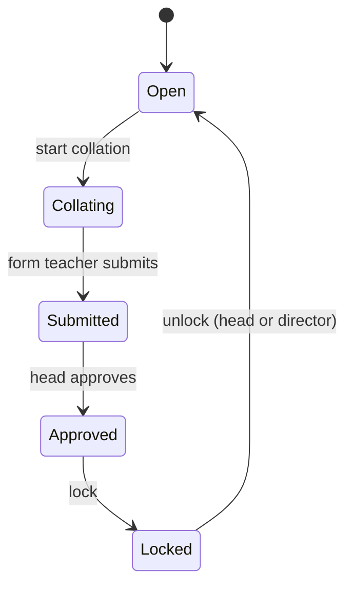

# Grading and results

Grading is open-ended: teachers design their own schemes instead of the system forcing one formula on every school.

## Grading schemes

A scheme belongs to a class, a subject, an academic year and a term. It has:

- **Components**, each with a weight and a default maximum score. For example: class work 30%, tests 20%, end-of-term exam 50%.
- **Grade boundaries**, which turn a total into a letter grade.
- **A status**: draft, pending approval, active or archived.

A teacher drafts a scheme and requests activation; it only counts once approved. Changing an active scheme creates a new version instead of overwriting it, and every computed result records the version it used, so old results stay explainable.

## Assessments and scores

Each assessment belongs to one component of the active scheme. Scores can be entered one at a time or for the whole class at once. Support teachers can only enter scores for their own subjects; form teachers can see every subject's marks for their class.

## Term results and result locks

From the scores, the system computes each student's total, grade and position in the class for each subject and term. A class's results then move through a lock:

Once results are locked they can't be edited, which protects report cards and promotion decisions from late changes. Heads approve, lock and unlock results for their own school, directors for their region, and every step is written to the audit log.

## Reports

Heads and directors get class-performance reports built from term results, and directors see them across every school in their region.
